<!-- Profile README: Maanya Tyagi -->
<div align="center">




<a href="https://git.io/typing-svg"></a>

<p>
<a href="https://www.linkedin.com/in/maanya-tyagi-mt05/"></a>
<a href="https://www.mavionix.in"></a>
<a href="mailto:maanyatyagi4@gmail.com"></a>
</p>

<p>


</p>
</div>

---

## 🧠 Researcher / Builder Manifest

I'm **Maanya Tyagi**, a B.Tech student in **Computer Science & Engineering (Data Science)** at **SRM Institute of Science & Technology**, Ghaziabad (2028).

I am interested in understanding intelligence from two complementary directions: the biological systems that produce cognition, and the computational systems we build to learn, reason, and act. My developing research interests centre on **neuroscience, cognitive processes, neural dynamics, and AI/ML**.

Alongside academics and research, I build technology projects and lead product development as Founder of **MaVionix India Private Limited**.

```python
class ResearcherBuilder:
    name = "Maanya Tyagi"
    base = "Delhi, India"
    education = "B.Tech CSE — Data Science, SRM IST"
    graduation = 2028
    interests = [
        "Neuroscience & cognitive science",
        "Computational neuroscience",
        "Neural dynamics & representation",
        "Artificial intelligence & machine learning",
        "Computer vision, robotics & intelligent systems",
    ]
    roles = ["Student", "Research Contributor", "Founder @ MaVionix"]

    def mission(self):
        return "Understand intelligence. Build systems that extend it."
```

## 📊 Research & Publication Snapshot

<div align="center">

| Research output | Count | Current status |
|:--|:--:|:--|
| Conference papers | **8** | Accepted and presented |
| Journal articles | **2** | Under review |
| Indian design applications | **1** | Co-applicant; application no. 498807-001 |
| Granted patents | **0** | No granted patent listed in current CV |

</div>

### 🎤 Conference papers — 8 accepted and presented

<details>
<summary><b>View all conference papers and venues</b></summary>

1. **MaVionix: A Low-Power AI-Enabled Platform for Sustainable Digital Services in Rural Enterprises** — ICSTAIS 2026, Chandigarh University.
2. **Machine Learning-Based Optimization of Digital Logic Gate Networks for Power and Delay Reduction** — ACIFFS 2026, Manipal University Jaipur.
3. **Spectrastro: A Multi-Modal Database-Integrated Deep Learning Framework for Planetary Spectral Data Analysis** — ACIFFS 2026, Manipal University Jaipur.
4. **AI-Driven EDA Optimization for VLSI Design Automation Using Multi-Stage Deep Reinforcement Learning** — ICETT 2026, NIT Jalandhar.
5. **A Multi-Modal AI Framework for Safety Intelligence in Heavy-Duty Trucks Using Computer Vision, IoT Sensor Fusion, and Explainable AI** — ICSIE 2026.
6. **Smart Obstacle Detection System for Visually Impaired Navigation Using Ultrasonic Sensing** — ICSIE 2026.
7. **SensePath: A Low-Cost Multi-Sensor Assistive Cane with Real-Time Hazard Prioritization for the Visually Impaired** — NCPTSD-26.
8. **MVediScan AI: A Deep Learning-Based Mobile Diagnostic Assistant for Multi-Modal Medical Analysis** — NCPTSD-26.

</details>

### 📚 Journal / article manuscripts — 2 under review

<details>
<summary><b>View manuscripts</b></summary>

- **Calibrated Probabilistic Photometric Redshifts from Sky-Disjoint Validation of Gradient-Boosted Ensembles on SDSS DR17, with a Pantheon+SH0ES Late-Universe Baseline** — Under Review.
- **Selection-Aware Photometric Redshift Estimation with Deep Mixture-Density Networks and Conformal Calibration Using DESI DR1** — Under Review.

</details>

### 📐 Intellectual property

- **Smart Robotic Pipeline Maintenance Device** — Co-applicant, Indian Design Application No. **498807-001**, Government of India (CGPDTM), 2026.
- Patent count is shown separately from design applications; this application is not represented as a granted patent.

## 🔬 Research interests & questions

- **Cognitive neuroscience:** attention, perception, learning, memory, and cognitive adaptation.
- **Computational neuroscience:** mathematical and machine-learning approaches to neural systems.
- **Neural dynamics:** how neural activity and representations evolve over time.
- **AI for science:** computational methods for extracting patterns from complex scientific data.
- **Human-centred AI:** assistive, interpretable, and accessible intelligent systems.

**Questions I hope to investigate**
- How does neural activity reorganise before, during, and after a stimulus-driven task?
- How do attention and task demands influence the temporal structure of neural representations?
- How can computational models connect sensorimotor representations with observable behaviour?

*These are developing research interests and hypotheses, not claims of completed neuroscience findings.*

## 🛰️ Academic & builder journey

| Period | Milestone |
|:--|:--|
| 2021 | Completed CBSE Class X — 95% |
| 2023 | Completed CBSE Class XII — 82% |
| 2024 | Joined SRM IST; contributed as ML Engineer to SRM Campus Delivery System hackathon project |
| 2025–Present | Founder, MaVionix India Pvt. Ltd.; leading product, technology, and innovation initiatives |
| 2025 | Project lead — ARAK-1 industrial pipeline inspection robot |
| 2026 | Co-authored and presented conference research; journal manuscripts under review; design application as co-applicant |

## 🚀 Selected projects

| Project | What it explores | Focus |
|:--|:--|:--|
| **ARAK-1** | Quadruped robot concept for hazardous pipeline inspection, sensing gas, temperature, cracks, and obstacles, with a proposed epoxy repair mechanism | Robotics · AIoT · Embedded systems |
| **AI Dance Tutor** | Pose-estimation-based movement comparison and adaptive practice support | Computer vision · Pose estimation |
| **MaVionix AI** | Unified AI platform concept for development, creative workflows, business tasks, and automation | Applied AI · SaaS · Agents |
| **SRM Campus Delivery System** | Real-time campus delivery solution built in a hackathon context | ML · Product engineering |

## 🏢 Founder / MaVionix

I founded **MaVionix India Private Limited** to explore AI-native technology products, digital automation, and intelligent systems for organisations. My work spans product direction, business strategy, technology development, stakeholder engagement, and coordinating cross-functional execution.

**Core idea:** make powerful digital capabilities easier to access through context-aware AI and connected workflows.

[🌐 mavionix.in](https://www.mavionix.in)

## 🏆 Recognition & achievements

<div align="center">

| Recognition | Detail |
|:--|:--|
| 🥇 **Winner** | Thrust Tech Expo — IIT Hyderabad |
| 🥇 **Winner** | Innovathon 1.0 — University of Jammu |
| 🎖️ **Appreciation Prize** | Anveshana — New Delhi |
| 🏅 **Finalist** | Multiple AI and technology hackathons |
| 💃 **District Champion** | Dance |

</div>

## 🧰 Technical toolkit

<p align="center"><b>Programming & data</b><br/>
</p>
<p align="center"><b>AI / ML & computer vision</b><br/>
</p>
<p align="center"><b>Engineering & tools</b><br/>
</p>

**Research & technical methods:** Machine Learning · Deep Learning · Multimodal AI · NLP · Reinforcement Learning · Object Detection · Pose Estimation · Statistical Modelling · Probability · Optimization · Sensor Integration · Robotics.

## 📈 GitHub telemetry

<div align="center">

<br/>


<br/>

</div>

## 🌐 Connect & collaborate

<p align="center">
<a href="https://www.linkedin.com/in/maanya-tyagi-mt05/"></a>
<a href="mailto:maanyatyagi4@gmail.com"></a>
<a href="https://www.mavionix.in"></a>
<a href="https://github.com/Maanya12345?tab=repositories"></a>
</p>

<div align="center">

**Curiosity → Research → Models → Real-world systems**

*Open to meaningful collaborations in neuroscience, AI/ML, computational research, robotics, and human-centred technology.*


</div>
